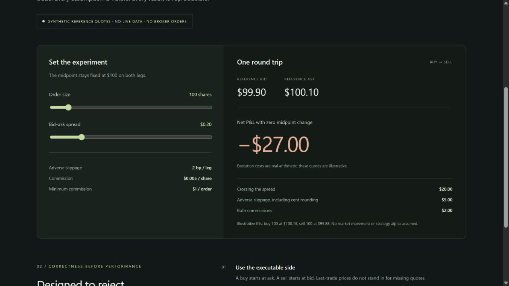

# QuantDesk · Engineering Showcase

A curated demonstration of execution-aware quantitative research engineering: explicit transaction costs, defensive market-data validation, reproducible experiments, and tests that challenge misleading paper returns.

**This is a public portfolio, not the complete platform.** The complete QuantDesk application, strategy development, internal backtest framework and research experiments remain in the private `quantdesk` repository. No private strategy definitions, user records, credentials, or production infrastructure identifiers are included here.

[Open the interactive demonstration](https://wilberdu001.github.io/quantdesk-public/)

## Run the demonstration

Requires Node.js 22 or newer. No dependencies, API keys, broker accounts or cloud resources are needed.

```sh
npm test
npm run experiment
npm start
```

Open **http://localhost:4174**. The interactive cost laboratory uses **synthetic reference quotes**, visibly labeled throughout. It does not fetch live data or send orders. The same demonstration can be hosted as static files from the repository root.



## Selected technical work

The [market-data trust contract](docs/data-trust.md) explains provenance, timestamp, price-type, session and coverage checks used to prevent misleading research claims.

- A deterministic execution planner that starts buys at ask and sells at bid, applies adverse slippage, rounds conservatively, and reports commission separately.
- Validation of stale, delayed, crossed and invalid quotes, plus conservative available-quantity checks with explicit consumption input.
- Tests for symmetric costs, side-specific liquidity, invalid data and repeatable experiments.
- A standalone browser demonstration with input controls, a cost breakdown, and a transparent quote clock.

The public planner is a selected, general-purpose implementation used by the private platform. It does not include internal strategy selection, the full order lifecycle, account persistence, authentication or the research/backtest engine.

## Reproducible result

At a constant reference midpoint of **$100**, with bid **$99.90**, ask **$100.10**, and **100 shares**:

| Model component | Round-trip cost |
|---|---:|
| Crossing the spread | $20 |
| Adverse 2 bp slippage, rounded against the trader | $5 |
| Commission: $0.005/share, minimum $1 per order | $2 |
| **Net P&L with no price movement** | **−$27** |

The gross midpoint-to-midpoint return is zero. The loss arises entirely from explicit execution assumptions. This is a correctness experiment, **not a return forecast, trading strategy backtest, or live performance claim**. Recreate every scenario with `npm run experiment`; results are committed in [results/execution-costs.json](results/execution-costs.json).

## Architecture and method

See [architecture](docs/architecture.md) and [research methodology](docs/methodology.md) for the private platform's high-level boundaries, the public demonstration's implementation, experiment controls and limitations.

The private platform separately tests accounting conservation, partial exits, reversals, fee allocation, pending-order limits/stops and robot/account attribution. Those internal modules and their full experimental history are intentionally outside this public repository.

## Limits

Fees and slippage here are stated model assumptions, not a broker tariff. Visible quote quantity is a conservative bound, not a guarantee of liquidity. The public planner expects the caller to persist consumption; the demo does not operate a persistent account. There is no order queue, depth sweep, partial-fill simulator, borrowing model, taxes or strategy alpha in this showcase. A real market-data integration requires suitable timestamps, data permissions and a separately validated execution service.

Order semantics reference: [SEC Investor.gov — Types of Orders](https://www.investor.gov/introduction-investing/investing-basics/how-stock-markets-work/types-orders).

Selected portable research: [temporal validation](docs/temporal-validation.md), with causal parameter selection and nonoverlapping walk-forward folds.

See [isolated strategy books](docs/strategy-books.md) for accounting and concurrency boundaries.

[Persisted paper robot runtime](docs/server-runtime.md) describes restart, scheduling, risk and concurrent pause behavior.

The [guided learning contract](docs/guided-learning.md) distinguishes tool evidence from synthetic exercises and self-checks. Version 1.1 adds temporal-validation examples, strategy-book and server-runtime architecture, and an English-only learning exercise.

Version 1.2 improves the responsive learning exercise and documents the [research interface design](docs/interface-design.md).

Version 1.2.1 documents [open-session server verification](docs/open-session-verification.md), including a post-fill equity-mark defect and a fully synthetic accounting regression.

Version 1.2.2 explains [account state consistency](docs/state-consistency.md), with synthetic regressions for stale inventory and lost save acknowledgements.
