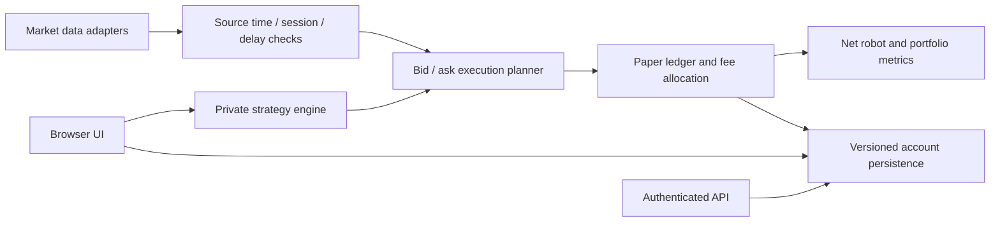
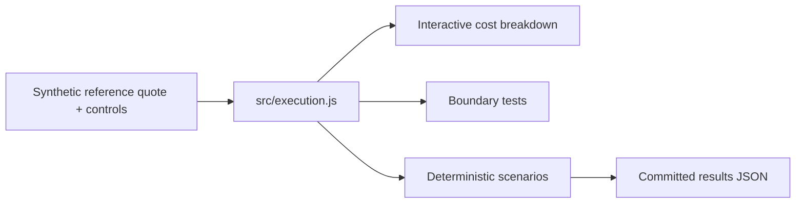

# Architecture

## Complete platform (private)

The browser frontend coordinates simulated trading and analysis; an API service handles market-data adapters, authentication and versioned state persistence. Simulated-data and market-data accounts are isolated. This high-level diagram deliberately omits deployment identifiers, private strategies and internal framework implementation.

## This repository (public)

The public build has no backend, external data connection, credentials, user data or broker integration. `scripts/serve.mjs` is an optional localhost static server. The demo imports only the public planner and reads the user's illustrative inputs.
