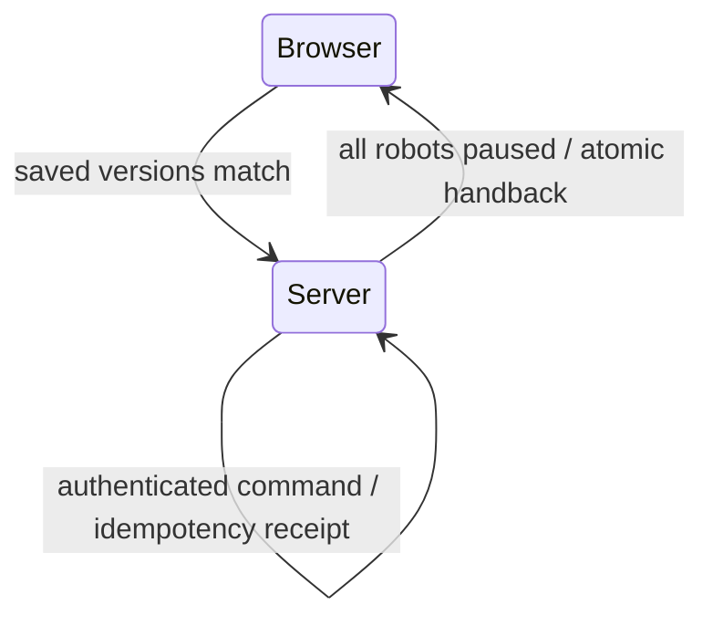

# Durable teaching simulations

This case study describes a synthetic teaching workload. It is separate from live-market paper execution. No private strategy, account record, production identifier or market-data permission is included.

## One authoritative writer

Browser timers stop when a page closes or the computer sleeps. Persisting a `running` label cannot make a browser timer a server process. The runtime therefore transfers ownership of a reviewed, versioned snapshot to the scheduler. The snapshot contains the existing teaching book, robot configuration, custom definitions and synthetic prices. Adoption does not reset cash or start deliberately paused robots.

The scheduler commits a completed minute with a revision compare-and-swap. A stale worker may compute, but cannot overwrite a newer manual command or commit the same minute twice. A database transaction includes the authoritative revision and new order archive records. Missing minute windows are not replayed as invented fills.

Old browser writes are fenced inside the database write statement, including old requests with otherwise valid versions. Other account preferences and the separate market-data environment remain independent. A return to browser control atomically publishes the latest entries and advances their legacy revisions.

## Shared code, separate models

The teaching runner builds its strategy and matching code from the browser sources at build time. It does not use runtime `eval` or copy unpublished strategy definitions into this showcase. The browser displays committed synthetic prices rather than advancing a second market. The private build checks that the generated engine matches its source.

Synthetic random market-making remains an educational probability model. Moving that model to a server does not establish real-market profitability, actual liquidity or a brokerage execution record.

## History without repeated storage

The visible recent-order list remains bounded. A separate append-only archive preserves its previous entries and subsequent terminal orders, including expired pending orders. Content identity avoids re-storing identical records and preserves distinct trades whose legacy numeric IDs may repeat after an explicitly requested reset. Only new terminal records are considered after the initial archive pass. No historical records are deleted to reduce storage.

## Verification boundaries

Local verification used the actual Worker runtime and an isolated persistent database through ordinary authenticated endpoints. A disposable teaching book retained an existing position, historical order and custom definition while signal and market-making robots executed. The teaching page was actually closed. After a local runtime restart, another scheduling invocation advanced the persisted state without repeating the original signal entry. Cash was independently reconstructed from archived fills. The disposable robots were paused, positions closed and state returned without resetting the account.

Local scheduler invocations are not evidence of a production cron or real-market execution. Production deployment and cross-deployment observation require separate evidence. The standalone public example models the revision and ownership contract; it is not an account service or robot implementation.

See [the pure ownership example](../src/scheduled-owner.js) and [its tests](../tests/scheduled-owner.test.mjs). Run `npm test` without dependencies or credentials.

## Handoff races found before production rollout

Additional synthetic regression work found two browser handoff defects before this candidate was deployed: an adoption request could continue after an account switch, and a committed server snapshot could discard an unsaved local book without preserving a recovery copy. The private candidate now checks the account generation after each asynchronous boundary. It freezes local teaching computation and mutations during adoption, preserving deliberately running robot statuses. An uncertain acknowledgement retains the original command and keeps the browser fenced until server ownership is confirmed.

Unsaved conflicting records are preserved in account-scoped recovery storage before replacing the display cache. A late response from the legacy save endpoint cannot restore an old book over the authoritative snapshot. Six additional regressions cover these boundaries; the private suite has 140 passing checks. These are synthetic regression results, not production cron or live-market evidence.
